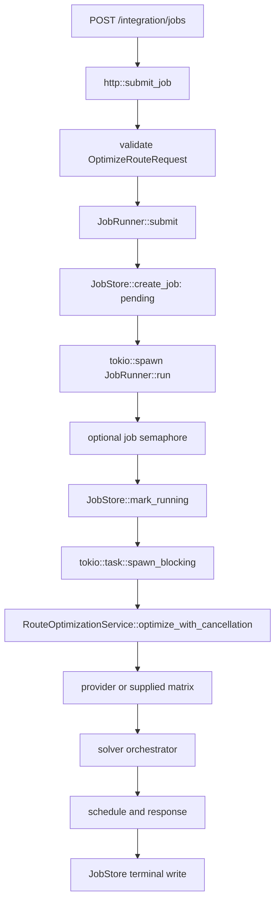

# Request lifecycle

This document follows the production request path implemented by the current
server. The file-backed `JobStore` is authoritative for asynchronous job state;
the in-memory cancellation registry and event subscribers only coordinate work
that is active in this process.

## Asynchronous Job API

`http::submit_job` validates the domain conversion before accepting the job.
`JobRunner::submit_with_completion` then creates the persisted `pending` record;
this creation is also the authoritative duplicate-ID check. It installs a
`CancellationToken` in the active-job registry and starts an async task.

`JobRunner::run_inner` waits asynchronously for the finite
`TROUTE_MAX_CONCURRENT_JOBS` semaphore and marks the persisted record `running`.
Admission is separately bounded by `TROUTE_MAX_OUTSTANDING_JOBS`; the permit is
released on every terminal outcome, including cancellation and failure.
The CPU/blocking provider-to-schedule pipeline runs in Tokio's blocking pool.
Progress travels back through an unbounded channel, so storage updates and SSE
publication remain on the async side. The runner finally persists exactly one
of `completed`, `failed`, or `cancelled` and removes the active token.

## Legacy synchronous API

`POST /optimize` uses the same persisted runner when the application has a Job
store. It calls `submit_with_completion`, awaits its one-shot completion signal,
loads the terminal record, and converts that record back to the legacy response.
This does not create a second optimization pipeline. Routers constructed without
storage keep a compatibility path that invokes the executor once in
`spawn_blocking`.

`POST /integration/matrix` only performs validation and matrix building; it does
not run a solver or create a Job. A separate finite semaphore rejects excess
preview work immediately rather than consuming the Job queue.

## Reads, events, and cancellation

- `GET /integration/jobs` and `GET /integration/jobs/{job_id}` read the
  authoritative `JobStore`.
- `GET /integration/jobs/{job_id}/events` first uses the active in-process
  subscription when available. A slow or reconnecting reader can recover from
  persisted state rather than blocking the worker.
- `POST /integration/jobs/{job_id}/cancel` transitions the stored Job to
  `cancelled` and signals its active `CancellationToken`. A queued Job observes
  cancellation while waiting for a permit; routing, solving, remediation, and
  result assembly check the same token cooperatively.

The cancellation endpoint acknowledges a request; it does not forcibly kill a
thread. Implementations must therefore keep cancellation checks in long loops
and external I/O polling.

## Process restart

`main::run` creates `FileJobStore` and calls `recover_interrupted` before binding
the HTTP listener. Jobs persisted as `pending` or `running` cannot resume their
old stack or external requests, so recovery writes them as interrupted failures.
Terminal records remain readable. In-memory cancellation tokens and live SSE
subscriptions are intentionally not recovered.

## Main implementation entries

- [`src/main.rs`](../../src/main.rs): dependency construction, recovery, server.
- [`src/http/router.rs`](../../src/http/router.rs): routes and admission policy.
- [`src/http/handlers`](../../src/http/handlers): request handlers and legacy adapter.
- [`src/jobs.rs`](../../src/jobs.rs): persistence transitions and blocking boundary;
- [`src/jobs/cancellation.rs`](../../src/jobs/cancellation.rs): active cancellation,
  progress/event forwarding, cancellation registry.
- [`src/service.rs`](../../src/service.rs): provider → matrix → solver → schedule.
- [`src/storage.rs`](../../src/storage.rs): authoritative Job state.
- [`src/observation.rs`](../../src/observation.rs): diagnostic request timeline;
  it is not the source of Job status.

