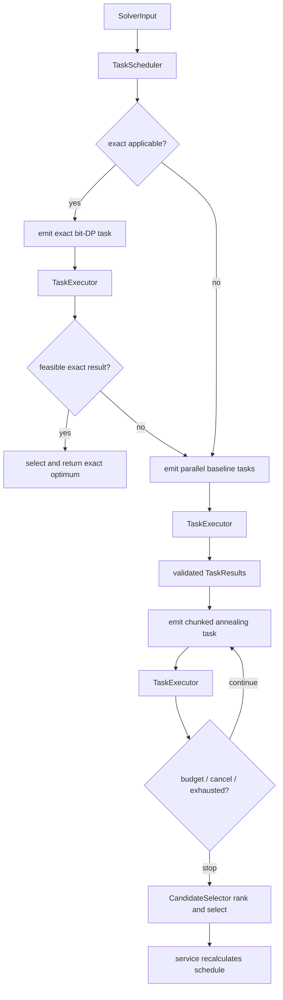

# Solver execution

`RouteOptimizationService::optimize_with_cancellation` owns the end-to-end
domain pipeline. It validates `OptimizeRouteRequest`, chooses a route provider
(unless a matrix was supplied), obtains a directed `TravelTimeMatrix`, and calls
the configured `RouteSolver`. The selected route is always scheduled again by
the minute-accurate schedule calculator before the response is emitted.

## Anytime orchestrator

The production `SolverOrchestrator` uses one total wall-clock budget, with a
safety margin reserved for selection, scheduling, and response assembly.

For a problem within the exact size limit, `exact_bit_dp` runs first. A feasible
exact result is an optimality proof under the exact solver's objective and ends
the search early with termination reason `exact_optimum`. An exact failure or an
inapplicable exact solver falls through to the baseline stage.

Applicable non-exact baseline strategies are pulled from a shared queue by at
most `SOLVER_MAX_CONCURRENCY` scoped worker threads. Every launch receives the
smaller of the per-strategy timeout and remaining global allowance. Results are
restored to registration order before diagnostics are assembled, keeping output
deterministic despite parallel execution.

After baseline work, simulated annealing runs repeatedly in
`SOLVER_SA_CHUNK_MS` chunks. Initializers rotate deterministically, the current
best route can be supplied as a warm start, and seeds are derived from the
configured base seed and restart round. Runs stop on cancellation, exhaustion,
or the shared deadline minus its safety margin.

When enabled, the SCIP MIP and operator-supplied LKH-3 adapters participate as
ordinary registered baseline strategies. SCIP is feature-gated and applies
native time/thread/memory limits. LKH runs as a bounded child process, and is
only used on a fixed selected subset for partial-visit problems. Both return
through the same validation, objective evaluation, cancellation, and candidate
metadata path as in-process strategies.

## Candidate validation and selection

`TaskExecutor` creates an `ExecutionContext` after acquiring the Task's resource
lease. The context owns the child cancellation token, local/global deadlines,
seed, warm start, and lease. A watcher signals cancellation when the parent Job
is cancelled or the task deadline expires. The returned visit order is
evaluated through the orchestrator's common `ObjectiveEvaluator`; a strategy
cannot make itself selectable merely by reporting its own score. The resulting
`TaskResult` records the independent Task/Solver identities, final task state,
feasibility, objective metrics, elapsed time, error/timeout information, and
strategy-specific metadata.

`CandidateSelector` ranks feasible candidates with the common objective policy
and deterministic tie breakers, then chooses the first candidate with a route.
The service asks the solver for the selected start time and calls
`calculate_schedule_from` against the problem and matrix. For a dated,
provider-routed request it then performs one bounded pass that re-queries the
selected legs at their actual schedule departure instants and recalculates the
schedule. This final
pass checks location windows, stay duration, travel, fixed endpoints, and the
single-day limit using the values serialized in the API response. If no solver
route is feasible, the service also evaluates the input order to improve the
reported failure classification.

## Budgets and cancellation

- `TROUTE_SOLVER_TOTAL_BUDGET_MS`: shared orchestrator deadline.
- `SOLVER_STRATEGY_TIMEOUT_MS`: upper bound for one strategy, clipped by the
  shared deadline.
- `SOLVER_SA_CHUNK_MS`: one anytime annealing slice.
- `SOLVER_DEADLINE_SAFETY_MS`: work intentionally left for finalization.

All stages receive the Job's cancellation token. Timeout child tokens avoid
letting one strategy consume the remaining shared budget; cooperative checks in
solver loops are still required.

## Main implementation entries

- [`src/service.rs`](../../src/service.rs): common pipeline and final schedule.
- [`src/solver/orchestrator/runner.rs`](../../src/solver/orchestrator/runner.rs):
  compatibility facade and final result coordination.
- [`src/solver/orchestrator/scheduler.rs`](../../src/solver/orchestrator/scheduler.rs):
  exact-first order, parallel baseline batches, SA follow-up tasks, and budgets.
- [`src/solver/orchestrator/executor.rs`](../../src/solver/orchestrator/executor.rs):
  common timeout, cancellation, lease, panic, and validation path.
- [`src/solver/orchestrator/selector.rs`](../../src/solver/orchestrator/selector.rs):
  candidate selection and diagnostics.
- [`src/solver/exact`](../../src/solver/exact): exact bit-DP and time frontier.
- [`src/solver/heuristic`](../../src/solver/heuristic): clustered and annealing
  strategies.
- [`src/schedule.rs`](../../src/schedule.rs): final authoritative itinerary.

